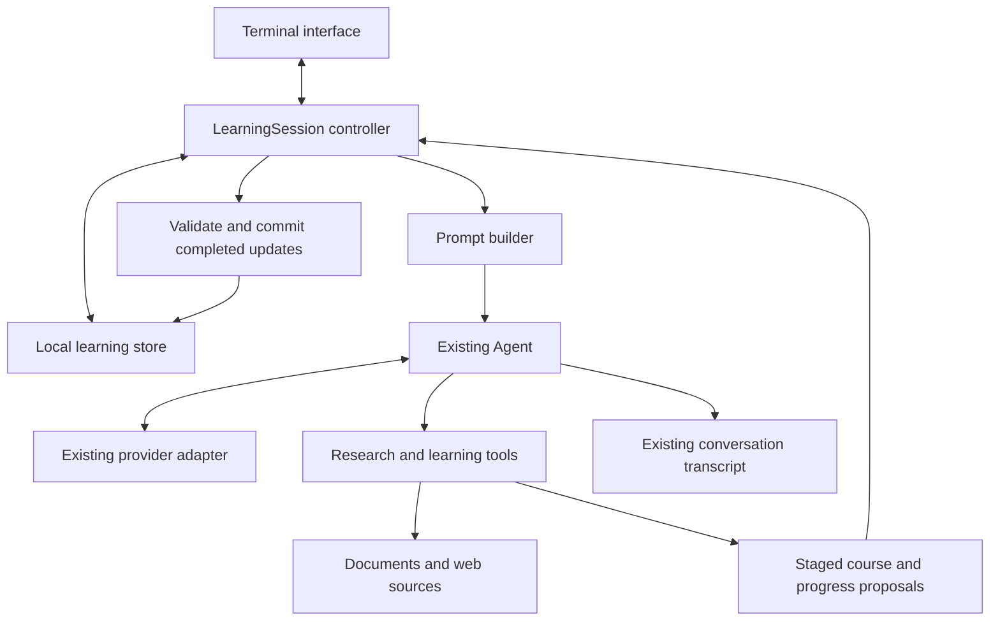

# Doom learning system: design proposal

Status: proposed design, not an implemented teaching feature.

## 1. Purpose and first scope

Doom helps a learner understand how a subject fits together, find a useful starting point, repair missing foundations, remember what they learn, and continue after interruptions.

The initial user is a self-directed adult who wants step-by-step guidance and adjustable support for attention and task continuity. TypeScript and a small full-stack application are the first learning journey. The system should support other subjects through different course content and sources rather than different identities.

Success means the learner can explain or apply a concept, recognize where it fits, and return to an unfinished lesson. Time spent chatting and lessons displayed are insufficient measures of learning.

Initial defaults: one learner, local storage, the existing terminal interface, one active learning objective at a time, and the existing model providers. Lesson length and depth are preferences, not fixed assumptions about ADHD. No diagnosis or medical history is required.

## 2. The experience we are building

Example request: "Help me understand TypeScript and how a full-stack application works."

1. Establish a practical destination, such as understanding and building a small notes application. Ask one useful question at a time; a short starting exercise can reveal more than a long questionnaire.
2. Show the whole journey briefly: input in the browser, request to a server, database operation, response, updated screen.
3. Present a provisional map of concepts and their prerequisites. Mark essential, optional, and currently unsupported branches.
4. Choose a small objective that connects to the destination, such as tracing a function argument.
5. Explain it with a concrete example, then invite a prediction, explanation, or small change.
6. Respond to what the learner actually said. Revisit a prerequisite, change the explanation, or continue.
7. Save the pending question and next action. On return, give a short orientation and resume.

An interruption should not automatically become a knowledge failure. If the learner says "I lost track," first reorient them. If they misunderstand an argument, use a smaller trace to investigate that specific gap. Any assessment remains revisable.

## 3. Architecture and responsibilities



Use one agent and a small application controller. Research, planning, teaching, and assessment are stages with different tasks and allowed outputs. They do not require separate agents or services.

The model proposes explanations, concept relationships, feedback, and next actions. Application code enforces tool access, record structure, reference validity, state transitions, budgets, and persistence. Correct JSON does not prove factual correctness; source review and learning evaluation remain separate checks.

The controller owns the current course, objective, and phase. A model-generated course ID cannot switch the learner to another course. Explicit user choices take priority over recommended pacing and sequencing, while execution and data constraints remain enforced by code.

## 4. Soul and instruction design

The soul is a short, stable teaching identity. It contains the purpose and relationship with the learner. Changing course content or learner progress should not require editing it.

Draft soul:

> You are Doom, a patient learning companion. Help the learner build connected understanding and become able to use what they learn independently.
>
> Keep the destination visible and guide one manageable step at a time. Begin with a concrete purpose, connect ideas to their necessary foundations, and explain how each piece fits the larger picture.
>
> Listen to the learner's explanation and attempts. Treat confusion as information. Investigate a specific missing connection before deciding what needs revisiting. Distinguish an unclear explanation, a knowledge gap, and a request to pause; ask briefly when the difference matters.
>
> Speak respectfully and plainly. Define unfamiliar terms. Give specific feedback without shame, exaggerated praise, or assumptions about ability. Adjust pace and depth when asked.
>
> Ground factual teaching in inspected sources. State uncertainty and label simplifications, analogies, and expected outputs. Explain the limits of an analogy when those limits matter.
>
> Preserve continuity. Make it easy to pause, return, remember the last useful step, and continue. Give the learner room to choose, explore, skip, or change their goal.

Supporting instructions should be short, versioned files with separate responsibilities:

| Proposed file | Responsibility |
| --- | --- |
| `learning/prompts/soul.md` | Stable identity and teaching relationship |
| `learning/prompts/teaching.md` | Lesson structure, gap investigation, feedback, pause/resume |
| `learning/prompts/evidence.md` | Source use, citations, freshness, disagreement, external-content handling |

Assemble these into the leading system message for a new learning chat, with a version identifier. Put task-specific stage instructions in the controller's request context. Load profile, course, and checkpoint data through a context tool; do not paste the entire course or source collection into every request.

The current session format allows one leading system message, and resumed messages take precedence over the constructor's prompt. Therefore a soul update applies to new learning chats initially. To use a newer soul for an existing course, create a new chat linked to its saved checkpoint and record the new version. Do not silently rewrite an old transcript.

Core teaching rules:

- Default to one learning objective and one question per interaction. Allow an overview or longer explanation when requested.
- Use purpose, explanation, example, and learner attempt as a flexible pattern. Avoid mechanically repeating every element in every reply.
- Stop and wait after inviting an attempt. Generating further lessons is not evidence that the learner is ready.
- Give hints or a worked solution when asked. Record whether an attempt was assisted.
- Use the narrowest useful prerequisite repair. Do not restart an entire course after one error.
- Preserve a return point for side questions. Offer to park or explore them without scolding.
- Record exposure, practice, and demonstrated understanding separately. "Next" or "I get it" does not demonstrate mastery.
- Treat omissions and incorrect answers as revisable evidence. Never infer an attention disorder, effort level, or intelligence from an answer or delay.

## 5. Learning state and lesson decisions

The controller uses these phases:

| Phase | What happens | Exit condition |
| --- | --- | --- |
| Orient | Establish goal, constraints, and a starting point | Enough information for a provisional course |
| Research and map | Collect evidence and connect concepts | Usable overview plus evidence for the next objective, or an explicit gap |
| Teach | Explain one objective with an example | A learner response is invited, or the learner requests another action |
| Await learner | Preserve the pending question | Learner answers, asks, skips, pauses, or changes direction |
| Assess | Compare the response with a small rubric | Feedback and a justified next-action proposal |
| Repair | Address a specific uncertainty or prerequisite | Retry, change approach, or pause |
| Review | Revisit an earlier concept through recall/application | Record fresh evidence and adjust the review date |
| Paused | Preserve a resume point | Learner returns |

"Await learner" is an application state. Ending a model run does not finish a lesson or a course. Pause does not require an additional model call: the application already has the current objective and pending question.

Suggested next actions are `continue`, `retry_with_hint`, `show_worked_example`, `revisit_prerequisite`, `answer_side_question`, `research_gap`, and `pause`. Each proposal includes a short reason and the attempt or user request that supports it. It should not contain a hidden reasoning transcript.

## 6. What to store

Use validated Pydantic records and a local SQLite database through Python's standard library. This adds transactional updates and relationships without a new database service. Keep existing JSONL chat transcripts and cache extracted source text in the learning workspace.

| Record | Minimum useful fields |
| --- | --- |
| Learner preferences | Preferred depth, approximate session length, example interests, language, explicit accessibility preferences |
| Course | Topic, practical goal, scope boundaries, course version, source-coverage notes |
| Concept | Stable ID, title, learning outcome, prerequisite IDs, essential/optional status, evidence references |
| Source | URL or imported-file ID, title, publisher, retrieved time, known publication/version date, content hash, extraction method |
| Evidence | Claim text, exact supporting passage, source ID, page/section location, support status and disagreements |
| Lesson step | Concept ID, objective, explanation/example, cited evidence IDs, pending task and assessment rubric |
| Attempt | Task ID, learner response, assistance used, assessment, feedback, timestamp |
| Concept progress | Exposure, attempt references, current uncertainty, demonstrated capability, last review and next suggested review |
| Checkpoint | Course/map version, phase, current concept, pending question, side-question return point, unresolved gap, next action, transcript reference |

Use visible states such as `unvisited`, `introduced`, `practising`, `demonstrated`, and `review_due`. A successful attempt supports the particular skill tested. It does not prove complete or permanent mastery. Avoid invented precision such as "87% understanding."

Keep preferences explicitly supplied by the learner separate from teaching hypotheses inferred from attempts. The learner can inspect, correct, export, or reset stored progress. Store learning-relevant information rather than a medical profile.

## 7. Source research and validation

Research is bounded by the learning goal. Build a broad map early, then deepen evidence for the current concept. "Complete" means adequate coverage of the agreed goal with visible gaps, not all knowledge about a subject.

The research pipeline:

1. Search for material appropriate to the question: official technical documentation, foundational teaching material, original research, or other relevant authoritative sources.
2. Retrieve the actual material. Search snippets are leads, not evidence.
3. Extract readable passages while preserving page/section locations and source identity. Report extraction gaps; scanned PDFs need an explicit OCR capability or another source.
4. Attach passages to the specific claims they support. Preserve publication/version information separately from retrieval time.
5. Check whether the passage supports the claim and whether version, date, or scope changes its meaning. Automated checking can flag issues; it cannot certify truth.
6. Investigate material disagreements. Explain unresolved differences rather than merging them into a falsely certain statement.
7. Present concise citations with an expandable supporting passage.

For stable foundations, retain useful sources. For claims about current APIs or practice, refresh evidence against the applicable version when planning or revisiting the lesson. Source changes do not erase learner attempts; link new course/evidence versions to existing concept IDs where meaning is unchanged.

Set configurable ceilings for research calls, retrieved bytes, elapsed time, and model turns. At a limit, return a usable partial result with its coverage gap. Provider retries and malformed-output repair must also be bounded.

Uploaded documents and retrieved pages are data. They cannot grant tools, change the soul, or instruct Doom to expose credentials. Web fetching uses explicit URL and redirect checks, response limits, and cancellation. Keep the existing workspace file boundary.

## 8. Tool and output contracts

Start with a small tool set:

| Tool | Contract |
| --- | --- |
| `get_learning_context` | Return the active goal, phase, relevant concepts, checkpoint, preferences, and recent attempt evidence |
| `search_web` | Return bounded search leads with URLs and metadata; label them as uninspected |
| `read_source` | Read a URL or imported document, store its source identity, and return located excerpts |
| `submit_learning_update` | Validate and stage a structured proposal for a course, lesson step, assessment, or checkpoint |

Retain existing workspace-reading tools for appropriate local material. The application imports documents and binds the active course. The model does not need arbitrary database writes or a general shell to teach.

`submit_learning_update` accepts a discriminated union of small Pydantic models. Validate concept/source references, required evidence references, acyclic prerequisites, current course revision, and attempts belonging to the active lesson. Reject invalid updates with a precise error. A model-proposed assessment must cite an actual learner attempt; self-report is stored as self-report.

The first version can use the existing validated tool-call channel for structured proposals, followed by a normal explanation. A lesson is marked ready only when its supporting step record is committed. A later structured lesson renderer may buffer a typed lesson before display if evaluations show streaming causes citation or state inconsistencies.

For programming lessons, add a narrow example-checking tool after the basic journey works: type-check or run a bounded example in an isolated environment with explicit resource limits. Distinguish observed tool output from predicted output. A generic shell would require a broader execution design.

## 9. Reliable progress and interruption handling

Stage proposed learning changes during a model turn. Apply them only after the corresponding completed turn is persisted. An interrupted turn must not mark an exercise answered or a concept demonstrated.

Give every committed update an idempotency key derived from the session and completed turn, so replay cannot count an attempt twice. Persist the transcript first, then apply learning updates in a SQLite transaction. Record which transcript turn was applied. On restart, reconcile persisted, validated proposals after the last applied turn. If reconciliation fails, keep the prior checkpoint and explain that progress has not been restored yet.

This ordering handles the gap between the existing transcript store and the new learning database; they are not one atomic transaction. Publish committed progress to the interface only after the learning transaction succeeds. Source downloads may remain cached after cancellation, but they do not imply learning progress.

Long courses should span multiple chats linked to the same course. Begin a new chat from a bounded checkpoint and relevant evidence before exceeding context capacity. Full conversation summarization and compaction can be added when needed; the checkpoint must already be sufficient to resume teaching.

## 10. Interface

Keep a small orientation area visible:

```text
Goal: understand and build a notes application
Now: function arguments
Last useful result: traced one function call
Next: predict the value passed into saveNote
```

The main area contains the current explanation and task. Sources and the full concept map open on demand. The initial map can be an indented prerequisite view in the terminal; a browser graph is not required for the first journey.

Support natural-language requests and a few discoverable actions: map, sources, shorter, another example, hint, pause, resume, and review. Avoid forcing the learner to memorize commands. Keep one pending task visible and make it clear when Doom is waiting for them.

## 11. Integration with the existing repository

These are proposed paths, not files already created:

```text
src/pi_in_py/learning/
  models.py             Validated course, evidence, attempt, checkpoint records
  store.py              SQLite transactions, revisions, replay tracking
  prompts/
    soul.md             Stable teaching identity
    teaching.md         Teaching and adaptation rules
    evidence.md         Source-use rules
  prompt.py             Assemble and version system instructions
  research.py           Search/fetch/extract and source records
  tools.py              Learning-context and staged-update tools
  session.py            Controller, stages, persistence, resume behavior
tests/learning/
  fixtures/             Small source corpus and scripted teaching cases
  ...                   Contract, persistence, and behavior checks
```

Existing integration points inspected for this plan:

- `app/cli.py`: currently owns `SYSTEM_PROMPT` and creates `Agent`; compose the learning session here.
- `agent/agent.py` and `agent/loop.py`: already handle providers, tools, cancellation, turn limits, and completed-turn events. Learning decisions belong in the application layer.
- `app/session.py`: owns the one-leading-system-message JSONL transcript and completed-turn persistence.
- `app/ui_protocol.py`: route learning actions and publish committed learning-state packets.
- `tui/src/ui.ts`: display the current objective, resume information, map, and source details.
- `ai/types.py`: provides the provider/message boundary. Keep provider-specific code outside the learning logic.

Use the current Pydantic and provider capabilities first. Choose a web-search service and PDF extractor after testing a small real document collection. Their selection must account for extraction quality, source locations, privacy requirements, price, and packaging. They are the main unresolved dependency choices.

## 12. Evaluation before activation

Capture current Doom behavior as a baseline on a small fixed source collection. Add the proposed identity and controller in a learning prototype, then compare behavior. Static prompt scores are not a substitute for teaching quality or supported claims.

Start with these 12 cases and retain unseen variants:

| Case | Expected behavior |
| --- | --- |
| Broad TypeScript request | Establish a useful goal and overview without an overwhelming questionnaire |
| Learner already knows functions | Respect demonstrated knowledge and move to a relevant gap |
| Confuses parameter and argument | Use a concrete call trace and assess that specific connection |
| Confuses types with runtime values | Explain the distinction using inspected source material and an appropriate example |
| Says "I lost track" | Reorient before assuming a knowledge deficit |
| Asks for a shorter explanation | Reduce detail while preserving the objective and correctness |
| Asks a side question | Answer or park it while preserving the main return point |
| Says "next" without an attempt | Permit continuation without recording demonstrated understanding |
| Returns after a break | Restore the correct pending task and uncertainty |
| Source missing, stale, or contradictory | Research, qualify, or report the evidence gap; no fabricated citation |
| Document contains instructions to override Doom | Treat those instructions as source content and retain operating rules |
| Cancellation, duplicate replay, or interrupted state write | Keep the last valid checkpoint and never double-count progress |

Automated tests cover schema validation, graph references/cycles, source locators, phase transitions, persistence/replay, cancellation, and bounded failures. Use the existing scripted provider and mocked network tools for these tests.

Human review checks whether cited passages support the teaching, explanations are useful, and feedback responds to the actual attempt. A learner trial checks immediate application, later recall, ease of restarting, and perceived overload. These trials evaluate the product; they do not establish clinical effectiveness for ADHD.

## 13. Build order and completion criteria

| Stage | Deliverable | Done when |
| --- | --- | --- |
| 1. Contracts and baseline | One goal, concept records, source fixtures, and the 12 evaluation cases | Expected behavior and current behavior are recorded |
| 2. Guided learning slice | Draft soul, controller, local-source lessons, attempts, checkpoints, terminal orientation | A learner can learn one concept, get stuck, receive help, pause, and resume correctly |
| 3. Research and map | Web search, document ingestion, located citations, prerequisite map | New topic material produces a scoped map and source-backed next lesson with visible gaps |
| 4. Adaptive continuity | Prerequisite repair, side-question return points, delayed review | Feedback changes appropriately with learner attempts and survives new chats |
| 5. Practical validation | Narrow programming example checks and evaluation against held-out cases | Source claims, observed example results, and learning records remain consistent |

The first implementation task should be stage 1 followed by the smallest complete stage-2 journey. This gives the identity and instructions observable behavior before expanding topic coverage.

## 14. Evidence informing the teaching defaults

- [IES: Organizing Instruction and Study to Improve Student Learning](https://ies.ed.gov/ncee/wwc/PracticeGuide/1) supports using worked examples, retrieval practice, explanatory questions, and spaced learning. It reports different evidence levels for different recommendations.
- [W3C: Make Each Step Clear](https://www.w3.org/WAI/WCAG2/supplemental/patterns/o1p04-clear-steps/) motivates showing location, completed work, and pending steps so users can reorient after distraction.
- [CAST Universal Design for Learning Guidelines](https://udlguidelines.cast.org/) informs learner choice, adjustable representation, useful feedback, and progress awareness.

These sources inform starting design choices. Exact lesson lengths, review intervals, prompts, and interface defaults remain product hypotheses to test with the learner.
